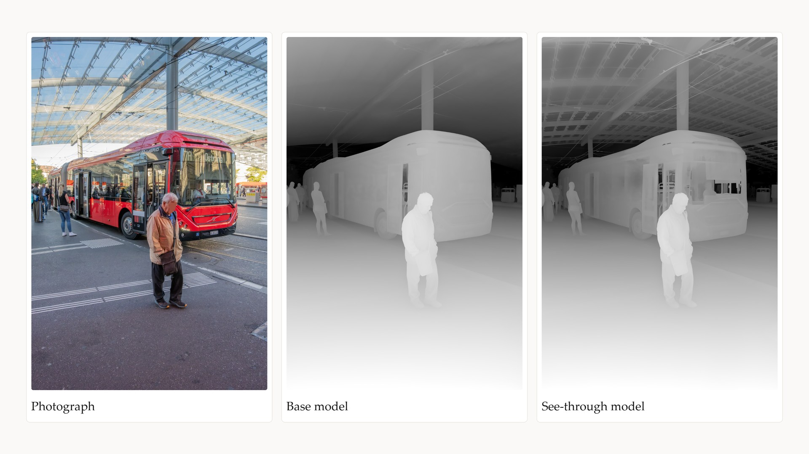

# ComfyUI-Marigold-V2-Tiled-Depth-Vathography

Custom node pack for full-resolution depth maps from high-resolution photographs, estimated tile by tile, for the Vathography art practice.

**The Vathography practice:** a photograph is distilled to a single element: the volume of the scene, creating a unique artwork, composed at capture, focused and shaped in post by the artist.

- **The volume:** estimated by inferring the depth map from a single photograph, using the Marigold V2 model.
- **The artwork:** originally meant to be an intermediate post-process pass, the depth map is elevated to the final artwork, through a process that gives full creative control to the artist.
- **The focus:** no longer determined by the lens at capture. When remapping the depth values, it becomes a creative choice, placed at any distance, on one subject or across several at once, sitting at different depths.
- **The expression:** the depth map is then shaped by the artist using contrast or color, from the quiet haze of atmospheric perspective to the stark contrast of opposing tonal values.
- **The photography:** this post-process changes the process itself, giving a new approach to photography. At capture, a photograph is composed purposefully for Vathography, reading a scene by its depth and volume rather than its light and color.

**Vathography tutorial:** https://youtu.be/DVYgwRaTKkA

**Vathography Blender add-on:** https://vathography.gumroad.com/l/addon

**Vathography website:** https://vathography.com/

---

## The nodes

**Marigold V2 Tiled Depth - Vathography** estimates the depth map of a high-resolution photograph by tiling it, keeping the photograph's full resolution. It works with two Marigold V2 models and recognises which one is loaded:

- **Base model:** the Marigold V2 depth model.
- **See-through model:** estimates the depth behind glass (windows, windshields, glass roofs) instead of stopping at the glass. Loaded with **Marigold V2 See-through Loader - Vathography**, on the 4-bit backbone the model was trained with.

**Install:** search *Marigold V2 Tiled Depth Vathography* in ComfyUI Manager, or clone into `ComfyUI/custom_nodes/`:

```
git clone https://github.com/vathography/ComfyUI-Marigold-V2-Tiled-Depth-Vathography
```

No extra Python packages required. Needs ComfyUI v0.36.0 or newer.

**Models:** 2 models can be used, the base model and the see-through model.

| Model | Model files |
|---|---|
| Base model | [Comfy-Org/marigold-v2-0](https://huggingface.co/Comfy-Org/marigold-v2-0), installed following the official guide: https://docs.comfy.org/tutorials/utility/marigold-v2 |
| See-through model | [Vathography/marigold-v2-see-through-comfyui](https://huggingface.co/Vathography/marigold-v2-see-through-comfyui) (converted from Marigold V2, Apache-2.0), plus the depth conditioning from [Comfy-Org/marigold-v2-0](https://huggingface.co/Comfy-Org/marigold-v2-0) |



**Use:** open the base model or the see-through example workflow in `example_workflows/`, load a photograph, run.

**GPU:** Estimated minimum requirements for both models: 8 GB VRAM + 24 GB RAM.

**License:** AGPL-3.0-only. Free nodes; the depth maps they produce are free to use, for personal and commercial work. See `LICENSE`.

**What's new in 1.1.0:** see-through depth (the loader node, its example workflow and model files). The straight-line fit for steep tiles now starts at 68× instead of 75×, so a few depth maps can differ slightly from 1.0.0.

By Karim Joseph Nassar, developed with Claude Code.

---

## Marigold V2 Credit and Links

- **Marigold V2 ComfyUI official guide:** https://docs.comfy.org/tutorials/utility/marigold-v2
- **The ComfyUI implementation** — native Marigold V2 support by the ComfyUI team: [models for ComfyUI](https://huggingface.co/Comfy-Org/marigold-v2-0)
- **See-through model files for ComfyUI** — converted from Marigold V2 by Vathography, Apache-2.0: [Vathography/marigold-v2-see-through-comfyui](https://huggingface.co/Vathography/marigold-v2-see-through-comfyui)
- **The model** — Marigold V2 by huawei-bayerlab, Apache-2.0: [code](https://github.com/huawei-bayerlab/marigold-v2) · [weights](https://huggingface.co/huawei-bayerlab/marigold-v2-0)

Thank you to the Marigold V2 team: Igor Pavlovic, Thiemo Wandel, Anton Obukhov, Luca Bartolomei, Andrey Davydov, Fabio Tosi, Matteo Poggi, Sabine Süsstrunk, Dengxin Dai.
https://huggingface.co/spaces/huawei-bayerlab/marigold-v2-web
